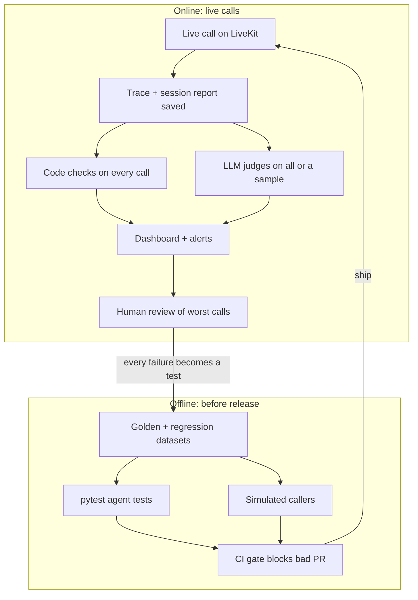

# Implementation Blueprint: the eval system for a bank voice agent

This is how large tech companies and AI startups actually build the eval system, mapped onto **our setup**:

- LiveKit Agents (Python), on our own server (self-hosted)
- every transcript and recording is saved
- two must-never rules: **guardrails never broken** and **answers match the knowledge base (KB)**

Sources were opened and checked on 2026-10-15. **[INFERENCE]** marks my own design suggestions that no source states directly.

---

## 1. The whole system in one picture

Every serious team runs two loops. The **offline** loop tests before release. The **online** loop scores live calls after release. Failures from live calls feed back into the offline tests.

The system has 8 building blocks (A–H). Each one below follows the same shape: what it is, how real teams built it, how we build it on LiveKit, and what to read.

---

## A. Capture every call as a trace

**What:** one structured record per call: turns, tool calls, timings, and the KB passages that were used.

**How real teams do it:**
- Anthropic: log every transcript, and read transcripts before trusting any score ([post](https://www.anthropic.com/engineering/demystifying-evals-for-ai-agents)).
- Airbnb rebuilds agent traces from the span tree and evaluates at the step, trajectory and session level ([post](https://airbnb.tech/ai-ml/eval-driven-development-lessons-from-evaluating-genai-at-scale)).

**How we do it on LiveKit (self-hosted):**

| Need | LiveKit feature | Works self-hosted? |
|---|---|---|
| Full call as JSON | `ctx.make_session_report()` inside `on_session_end`, then `.to_dict()` | Yes. The docs say it runs "entirely in your agent process" and "works for self-hosted deployments" |
| Tool calls + LLM spans | OpenTelemetry via `from livekit.agents.telemetry import set_tracer_provider` | Yes (OTel to any backend) |
| Per-turn latency | `ChatMessage.metrics`: `e2e_latency`, `llm_node_ttft`, `tts_node_ttfb`, `transcription_delay` | Yes |
| Interruptions | `InterruptionMetrics` in `livekit.agents.metrics` | Yes |
| LiveKit Cloud "Agent insights" | Dashboard | **No.** The docs say it "doesn't work with self-hosted media servers" |

**Read:** [LiveKit tracing](https://docs.livekit.io/deploy/observability/tracing.md), [LiveKit data hooks](https://docs.livekit.io/agents/observability/data.md), example `examples/voice_agents/otel_trace.py` in [`livekit/agents`](https://github.com/livekit/agents), [Langfuse LiveKit integration](https://langfuse.com/integrations/frameworks/livekit).

---

## B. Datasets: golden, regression, holdout

**What:** the fixed sets of calls you test against.

**How real teams do it:**
- Monzo: a golden set of 100 conversations "approved by subject matter experts", replayed message by message ([post](https://monzo.com/blog/engineering-the-future-of-customer-operations-the-monzo-ops-agent)).
- Ramp: golden sets reviewed by their own team, because user actions are "frequently lenient", so they are not ground truth ([post](https://builders.ramp.com/post/how-to-build-agents-users-can-trust)).
- OpenAI's realtime guide: a gold seed set of 10–50, plus regression, rolling-discovery and holdout sets ([guide](https://developers.openai.com/cookbook/examples/realtime_eval_guide)).
- Nubank: 90 to 888 labeled rows per judge, split 40/30/30 ([paper](https://arxiv.org/html/2606.08867)).

**How we do it:** pull from our saved transcripts:

| Set | What goes in | Size to start |
|---|---|---|
| Golden | Calls labeled pass/fail by a compliance or ops expert | 50–100, with bad calls included |
| Regression | Every production failure we find | Grows over time |
| Holdout | Labeled calls never used to tune prompts or judges | 30% of labels |

---

## C. Graders for our two must-never rules

### C1. Guardrails: code checks first

**How real teams do it:**
- Ramp puts dollar limits, vendor blocklists and category rules in plain code under the LLM.
- GitHub scores tool calls as {expected tool, expected args} with precision and recall ([post](https://github.blog/ai-and-ml/generative-ai/measuring-what-matters-how-offline-evaluation-of-github-mcp-server-works/)).
- Sierra's τ-bench checks the final database state, not the agent's words (`src/tau2/evaluator/evaluator_env.py`).

**How we do it [INFERENCE]:** run these on the session report of **every** call. They are cheap and exact.

| Guardrail example | Code check |
|---|---|
| Identity verified before account info | In the tool-call order, `verify_identity` succeeded before `get_balance` / `get_transactions` |
| Never read back a card number | No 13–19 digit sequence in agent text |
| Handoff when the caller asks for a human | If the user says "agent / human / representative", the transfer tool was called |
| No forbidden promises | Agent text has no phrases from a blocklist ("fee waived", "guaranteed") |
| Right action really happened | Backend state after the call matches the request (card status = frozen) |

### C2. KB compliance: an LLM judge, checked against humans

**How real teams do it:**
- Nubank's auditor LLM scores **every** conversation on binary criteria. One of them is **Correctness**: does the answer contradict the internal KB? ([blog](https://building.nu.com/building-ai-agents-for-131-million-customers/))
- Hamel & Shreya: one judge per failure type, pass/fail only, at least 50 pass + 50 fail labels, report TPR and TNR on held-out data ([FAQ](https://hamel.dev/blog/posts/evals-faq/)).
- Airbnb: judge output is strict JSON `{"reason", "score": 1 or 0}`, and they iterate until judge–human agreement is in the high 80s–90s.
- Nubank: trust a judge only when agreement κ > 0.8; they tune judge prompts with GEPA in DSPy.

**How we do it:**
1. The judge input is the user question, the agent answer, and **the KB passages the agent retrieved** (from the trace).
2. The judge answers: "Does the answer state anything that contradicts or is missing from these passages?" → `{"reason": ..., "score": 0 or 1}`.
3. Label 100 calls by hand. Measure TPR/TNR on the holdout set. Only then use it on live calls.

**Practice on a public benchmark:** τ-bench's `banking_knowledge` domain (700+ bank documents) in [`sierra-research/tau2-bench`](https://github.com/sierra-research/tau2-bench).

---

## D. Tests before release

### D1. Agent tests with pytest (runs locally)

**How real teams do it:** GitHub Copilot runs "more than 4,000 offline tests", mostly in CI ([post](https://github.blog/ai-and-ml/generative-ai/how-we-evaluate-models-for-github-copilot/)). Ramp: "Evals are the new unit tests."

**How we do it with LiveKit's built-in test helpers** ([docs](https://docs.livekit.io/testing/unit-tests.md)):
- `AgentSession(llm=...)` → `await session.start(OurAgent())` → `result = await session.run(user_input="...")`
- check events: `result.expect.next_event().is_message(role="assistant")`, then `.judge(llm, intent="...")`
- `mock_tools(OurAgent, {"get_balance": fake_fn})` replaces real bank APIs with fakes
- needs `pytest` + `pytest-asyncio`. The docs' judge example uses LiveKit Inference (hosted); whether any LLM plugin can be the judge on a self-hosted setup is **[INFERENCE]**, verify it in Lesson D1.

Example files: `examples/frontdesk/test_agent.py`, `examples/drive_thru/test_agent.py`.

### D2. Simulated callers

**How real teams do it:**
- Monzo: LLM users "grounded in real conversations"; tools hit a stateful simulator ("blocking a card updates its status").
- Nubank: 250 simulated conversations per version, a hypothesis and pass criterion written first; simulation screens, the live A/B test decides ([paper](https://arxiv.org/html/2609.30137v1)).
- Sierra τ-bench: `src/tau2/user/user_simulator.py` (class `UserSimulator`).

**Our options:**

| Option | Fits self-hosted? |
|---|---|
| LiveKit `lk agent simulate text/audio` | **No.** The docs say simulations "run on LiveKit Cloud" and require "A LiveKit Cloud project" |
| Our own simulator: a caller LLM with persona + goal sends turns into `session.run(...)`, with `mock_tools` keeping a fake bank state | Yes **[INFERENCE]**: copy τ-bench's `UserSimulator` design |
| Vendors that phone your agent (Coval, Hamming, Cekura) | Yes, over a phone number. Vendor claims, not verified |

---

## E. Voice-layer checks

**How real teams do it:**
- Sierra τ-voice: the same tasks as the text version, so the **text vs voice gap** is measurable; audio runs over 8 kHz phone quality with frame drops ([blog](https://sierra.ai/blog/tau-voice-benchmarking-real-time-voice-agents-on-real-world-tasks)).
- Pipecat `stt-benchmark`: semantic WER (only meaning-changing errors) and time-to-final-transcript, reported as p50/p95/p99 (`src/stt_benchmark/evaluation/semantic_wer.py`).
- OpenAI: Crawl (synthetic audio) → Walk (noisy real audio: `noisy`, `telephony`, `packet_loss`) → Run (multi-turn simulation).

**How we do it:**
- Take 50 saved recordings with amounts, dates and card digits. Hand-transcribe them. Measure WER **and** a number error rate for our STT. **[INFERENCE]** number error rate: "fifteen" vs "fifty" matters far more than "uh" vs "um".
- Latency: p50/p95 of `e2e_latency` per turn from the session reports.
- Interruptions: count from `InterruptionMetrics`.

---

## F. CI gate

**How real teams do it:**
- GitHub Copilot: tests in CI, **plus daily runs against production models**.
- LiveKit: text tests on every commit, audio nightly; their own repo has `.github/workflows/evals.yml`.
- Nubank: the full suite runs before any model change (GPT-5 needed new "tool-first" instructions).

**How we do it:** a GitHub Action runs the D1 pytest suite and C1 code checks on every PR. The PR fails if any guardrail test fails or a pass rate drops. Simulations and voice checks run nightly.

---

## G. Online scoring of live calls

**How real teams do it:**
- Nubank: auditor LLM on **100%** of conversations.
- Airbnb: "sample 5% of live de-identified traffic daily", flagged outputs go to human review, weekly PM review.
- Monzo: humans reviewed every message at first, then lowered the sample rate as confidence grew.

**How we do it:**
- C1 code checks on **100%** of calls (cheap).
- C2 KB judge on a sample first, then more once its TPR/TNR is proven.
- Tool: [Langfuse](https://langfuse.com/docs/evaluation/evaluation-methods/llm-as-a-judge) (open source, can be self-hosted) receives LiveKit OTel traces and runs LLM-as-judge on them. Use observation-level evaluators; trace-level ones are deprecated. Alternative: [Arize Phoenix](https://arize.com/docs/phoenix/evaluation/llm-evals).
- Every failing call → human review → regression set (block B).

---

## H. The report a bank's risk team reads

**How real teams do it:**
- Ramp reports **paired** metrics (Disagreement Rate *and* Unsure Rate), so a model can't look good by refusing ([post](https://builders.ramp.com/post/financial-benchmarks)).
- Anthropic: a benchmark score went 42% → 95% after grader bugs were fixed, so audit the grader.
- US bank model-risk guidance: [SR 26-2](https://www.federalreserve.gov/supervisionreg/srletters/SR2602.pdf).

**What goes in our weekly report:** each check's pass rate with sample size; each judge's TPR/TNR; pass^k on key tasks; worst slices (noisy calls, numbers, long calls); every guardrail failure with call id.

---

## Tools: what to use for each layer

| Layer | Open source / self-hostable | Paid vendors (examples) |
|---|---|---|
| Tracing + online judges | Langfuse, Arize Phoenix | Braintrust, LangSmith |
| Agent tests | LiveKit test helpers + pytest; promptfoo; `inspect_ai`; `intuit/fasteval` | — |
| Simulated callers | Own simulator (copy τ-bench `UserSimulator`) | LiveKit Cloud simulations, Coval, Hamming, Cekura |
| STT accuracy + latency | `pipecat-ai/stt-benchmark` method | — |
| Practice benchmark | τ-bench `banking_knowledge` | — |

**[INFERENCE]** For a bank, self-hostable tools usually win because call data can't leave your servers. Check this with your compliance team.

---

## Order to build it

Each phase only needs what came before it, and the first phases need no new infrastructure.

| Phase | Build | Uses blocks | Learning lessons |
|---|---|---|---|
| 1 | Read 30+ saved calls, list failure types | A | Lesson 2 |
| 2 | Code guardrail checks on saved session reports | A, C1 | Stage 2–3 |
| 3 | Label 100 calls; build + validate the KB judge | B, C2 | Stage 4 |
| 4 | pytest suite with `mock_tools`, in GitHub Actions | D1, F | Stage 2, 7 |
| 5 | Langfuse: traces + judges on live calls | A, G | Stage 7 |
| 6 | Own simulated callers; voice metrics from recordings | D2, E | Stage 5–6 |
| 7 | Weekly report | H | Stage 8 |

Lessons for each phase are saved in [`lessons/`](lessons/).
