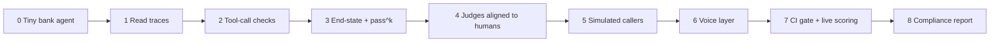

# Practical Evals Roadmap: learn it the way production teams built it

Every stage below starts from a **real team that shipped it**: what problem they had, what they built (their engineering blog), the **real code** you can open (OSS repo paths), and a **small copy you build yourself**.

All sources were opened and checked on **2026-10-15**. Numbers are quoted from the source. Anything we could not verify is marked **(unverified)**.

---

## The one project you build through every stage

You build **one small bank agent** and keep adding eval layers to it. By the end you have the same stack Nubank, Monzo and Sierra describe.

Every stage uses the same layout:

| Part | Meaning |
|---|---|
| **You will learn** | The skills and ideas this stage teaches |
| **Real problem** | What went wrong for a real team |
| **What they built** | From their engineering blog or paper |
| **Code to open** | Exact files in an open-source repo |
| **You build** | A small copy on your bank agent |
| **Done when** | A number you can show |

---

## Stage 0: The thing you will test

**You will learn:**
- What a **trace** is (the full record of one conversation) and how to save one as JSON
- How to write a **test task**: a caller goal plus the expected end state of the database
- Why a fake database and fake tools are what make an agent testable
- How τ-bench lays out a domain, so your project matches a real benchmark

**Copy this layout from:** τ-bench (Sierra). Every domain (airline, retail, telecom, banking) is a folder with the same files.

**Code to open:** [`sierra-research/tau2-bench`](https://github.com/sierra-research/tau2-bench)
- `src/tau2/domains/README.md` lists the files every domain has: `environment.py`, `tools.py`, `policy.md`, `db.json`, `tasks.json`, `tasks_voice.json`, `split_tasks.json`
- `src/tau2/domains/banking_knowledge/`: their banking domain (700+ documents, a `TransactionalDB` and a `KnowledgeBase`)

**You build:** a text-only bank agent with:
- `db.json`: 5 fake customers (balance, card status, last 10 transactions)
- `tools.py`: `verify_identity`, `get_balance`, `freeze_card`, `open_dispute`
- `policy.md`: rules like "verify identity before sharing any balance"
- `tasks.json`: 20 caller goals, each with the expected final DB state

**Done when:** you can run one task and save the full conversation (a **trace**) to a JSON file.

---

## Stage 1: Read traces before writing any metric

**You will learn:**
- **Error analysis**: reading conversations by hand to find what actually breaks
- **Open coding** (one free-text note per problem) and **axial coding** (grouping notes into failure types)
- How to turn notes into a ranked list of failure types with counts
- Why you read traces *before* choosing any metric

**Real problem:** teams wrote generic metrics ("helpfulness 1–10") that gave a score but didn't point to anything to fix.

**What they built:**
- **Hamel Husain & Shreya Shankar, [Evals FAQ](https://hamel.dev/blog/posts/evals-faq/):** read at least 30 traces yourself and write one note per problem ("open coding"). Then group the notes into failure types ("axial coding"). Keep going until new traces stop showing new failure types. They say they spend "60-80% of our development time on error analysis and evaluation."
- **Airbnb, [Eval-driven development](https://airbnb.tech/ai-ml/eval-driven-development-lessons-from-evaluating-genai-at-scale):** they started with "100 examples (synthetic is fine)" and read the outputs. They found 15 faithfulness failures, 8 verbosity, 5 over-refusal and 3 broken JSON. Only after that did they write graders.

**Code to open:** [`ai-evals-course/evals-skills`](https://github.com/ai-evals-course/evals-skills), `skills/error-discovery/SKILL.md` and `review-loop.md`. (The older `hamelsmu/evals-skills` repo is deprecated and points here.)

**You build:** run your 20 tasks, read 30+ traces, write `notes.csv` (trace id, what went wrong), then a failure-type table with counts.

**Done when:** you have a table like "identity skipped: 6, wrong amount: 4, no handoff: 2".

---

## Stage 2: Code checks on tool calls

**You will learn:**
- Writing **code graders** (checks in plain Python) and running them with pytest
- Scoring tool choice like a classifier: **precision**, **recall** and a **confusion matrix**
- Checking tool **arguments** separately: missing, made-up, or wrong values
- Checking the steps along the way, not only the final answer

**Real problem:** the agent calls the wrong tool, or the right tool with wrong arguments. You don't need an LLM to catch this.

**What they built:**
- **GitHub, [Offline evaluation of the MCP server](https://github.blog/ai-and-ml/generative-ai/measuring-what-matters-how-offline-evaluation-of-github-mcp-server-works/):** each test row is {input, expected tools, expected arguments}. Tool choice is scored like a classifier: precision, recall, F1 and a **confusion matrix** (a table of which tool was confused with which). Their example: `list_issues` vs `search_issues` gave precision 10/13 = 0.77 and recall 7/10 = 0.7. Arguments are scored separately: hallucinated args, missing required args, exact value match.
- **Ramp, [Meet Ramp Research](https://builders.ramp.com/post/meet-ramp-research):** their data agent's tests check "not only the final answer but also the intermediate steps, including expected tool calls, table references, and query shape."
- **LinkedIn, [Musings on building a GenAI product](https://www.linkedin.com/blog/engineering/generative-ai/musings-on-building-a-generative-ai-product):** about 10% of tool-call outputs had format errors. A defensive parser (plain code) cut that to about 0.01%.

**Code to open:**
- LiveKit: `livekit-agents/livekit/agents/voice/run_result.py` (class `RunResult`) in [`livekit/agents`](https://github.com/livekit/agents). Test shape from the [unit-test docs](https://docs.livekit.io/testing/unit-tests.md): `result = await session.run(user_input="...")`, then `result.expect.next_event().is_message(role="assistant")`, and `result.expect.no_more_events()`.
- Examples: `examples/frontdesk/test_agent.py`, `examples/drive_thru/test_agent.py`.

**You build:** 30 test cases with expected tool + args. Compute a tool confusion matrix and an "args exact match" rate with pytest.

**Done when:** you can say "tool choice: precision X, recall Y; args exact match Z%".

---

## Stage 3: Grade the end state, run it k times

**You will learn:**
- **Outcome grading**: checking what changed in the database, not what the agent said
- Combining checks so that one failed check fails the whole task
- **pass@k** vs **pass^k**, and why a bank cares about pass^k (it must work *every* time)
- Why the grader must be hidden from the agent

**Real problem:** the agent *says* "your card is frozen" but never freezes it. Or it works on run 1 and fails on run 3.

**What they built:**
- **Sierra, τ-bench ([`docs/evaluation.md`](https://github.com/sierra-research/tau2-bench/blob/main/docs/evaluation.md)):** a task's reward is the **product** of checks in `reward_basis`. The default is `["DB","COMMUNICATE"]`: was the database left in the right state, *and* did the agent tell the user the required facts. One failed check means 0.
- **Anthropic, [Demystifying evals for AI agents](https://www.anthropic.com/engineering/demystifying-evals-for-ai-agents):** "grade what the agent produced, not the path it took." Their pass^k example: 75% success per try gives 0.75³ ≈ 42% for passing all 3 tries.
- **Stripe, [Can AI agents build real Stripe integrations?](https://stripe.com/blog/can-ai-agents-build-real-stripe-integrations):** graders are deterministic tests that inspect the Stripe API objects that were actually created. The grader is **hidden from the agent** ("If the agent can read the server files, it trivially solves the eval"). Each task runs 3 times, and a Stripe engineer reviews the best transcript.

**Code to open:**
- `src/tau2/evaluator/evaluator_env.py` (DB check), `evaluator_communicate.py` (substring check), `evaluator.py`
- `src/tau2/metrics/agent_metrics.py`: `pass_hat_k(num_trials, success_count, k)` and `get_tasks_pass_hat_k(results)`
- [`stripe/ai/benchmarks/checkout-gym/`](https://github.com/stripe/ai/tree/main/benchmarks): `environment/`, `grader/`, `solution/`

**You build:** after each task, compare `db.json` to the expected state (DB check) and check the reply mentions required facts (communicate check). Run every task 5 times and report pass^1 and pass^5.

**Done when:** you have a table: task → pass^1, pass^5. The gap between them is your reliability problem.

---

## Stage 4: LLM judges you can trust

**You will learn:**
- Writing a **pass/fail judge prompt** for one failure type
- Building a **golden set** (hand-labeled examples, including bad ones) and splitting it into train/dev/test
- Measuring the judge: **TPR**, **TNR** and **Cohen's κ** (agreement beyond chance)
- Judge noise: re-running the judge to see how much its scores move
- How many labels you need, using **confidence intervals**

**Real problem:** some failures need judgment ("did it verify identity *before* sharing the balance?"). An LLM judge can check that, but the judge itself makes mistakes.

**What they built:**
- **Hamel & Shreya, [Evals FAQ](https://hamel.dev/blog/posts/evals-faq/):** one judge per failure type, pass/fail only. Label "at least 50 passing and 50 failing examples". Split into train/dev/test. Report **TPR** (how many real failures the judge catches) and **TNR** (how many good outputs it correctly passes).
- **Airbnb ([same post](https://airbnb.tech/ai-ml/eval-driven-development-lessons-from-evaluating-genai-at-scale)):** a golden set of 50–100 examples that "MUST include bad examples". Judge output is strict JSON `{"reason": ..., "score": 1 or 0}`. Judge–PM agreement went 78% → 88% after fixing the rubric. "3–5 well-calibrated LLM-as-judge evaluators beat 20–30 noisy ones."
- **Nubank, [KDD '26 paper](https://arxiv.org/html/2606.08867):** 5 binary judges with 90 to 888 labeled rows each, split 40/30/30. They tuned judge prompts with GEPA in DSPy. One judge went from 51% to 82% accuracy. Their trust bar is agreement (Cohen's κ) above 0.8.
- **Airbnb, [From weeks to a day](https://airbnb.tech/ai-ml/from-weeks-to-a-day-how-we-made-llm-evaluation-fast-enough-to-iterate-on/):** "the same judge drifts about one percent across runs." Re-run the judge on the same inputs before trusting a small score change.
- **Eugene Yan, [Product evals in three steps](https://eugeneyan.com/writing/product-evals/):** 200 samples at a 3% defect rate gives ±2.4%; 400 samples gives ±1.7%. Use this to pick how many labels you need.

**Code to open:**
- `evals-skills`: `validate-evaluator` and `write-judge-prompt` skills (SKILL.md contents unverified)
- Pipecat: `src/pipecat/evals/judge.py` (`EvalJudge`, `JudgeVerdict`) in [`pipecat-ai/pipecat`](https://github.com/pipecat-ai/pipecat)
- Phoenix [LLM evals docs](https://arize.com/docs/phoenix/evaluation/llm-evals): the judge must return a `label` plus an `explanation`

**You build:** an "identity verified before sharing account info" judge. Label 100 traces yourself (≥30 fails). Measure TPR/TNR on a held-out test set. Run the judge 5× and record the spread.

**Done when:** "judge TPR X, TNR Y on N held-out labels; spread across 5 runs Z".

---

## Stage 5: Simulated callers

**You will learn:**
- Building a **simulated caller**: an LLM with a persona and a goal
- A **stateful tool simulator**: fake tools that really update the fake database
- Writing a hypothesis and a pass criterion *before* running a simulation
- Why simulation is a screen and a live A/B test is the final judge

**Real problem:** you can't wait for real customers to find bugs, and a fixed script doesn't test a confused or angry caller.

**What they built:**
- **Monzo, [The Monzo Ops Agent](https://monzo.com/blog/engineering-the-future-of-customer-operations-the-monzo-ops-agent):** a golden set of 100 conversations "approved by subject matter experts", replayed message by message. There are three layers: component evals ("like unit tests"), answer-generation evals, and end-to-end evals on anonymised real conversations. Simulated users are LLMs "grounded in real conversations". Tools hit a **stateful simulator**: "blocking a card updates its status so future tool calls receive accurate responses."
- **Nubank, [Screen Before You Serve](https://arxiv.org/html/2609.30137v1):** synthetic customers talk to candidate agents, and tool calls return scenario-based fake results, so no real backend is touched. Each round has a written hypothesis and a pass criterion set *before* running. They ran 250 synthetic conversations per version. Simulation is a **screen**; the live A/B test decides.
- **DoorDash** (via [InfoQ](https://www.infoq.com/news/2026/03/doordash-llm-chatbot-simulator/); the primary blog returned 403, so this is secondary): an LLM plays the customer, seeded from historical transcripts, with backends mocked. They report about 90% fewer hallucinations from changes validated in the simulator.

**Code to open:**
- τ-bench: `src/tau2/user/user_simulator.py` (class `UserSimulator`), `user_simulator_base.py`
- LiveKit: `examples/frontdesk/simulation.py`, `examples/frontdesk/scenarios.yaml`; [simulation docs](https://docs.livekit.io/testing/simulations.md) (`on_simulation_end` hook for checking final state)
- Pipecat: `src/pipecat/evals/persona.py`, `simulation.py`, `simulation_driver.py`; scenario format in [docs](https://docs.pipecat.ai/pipecat/evals/overview) (`persona:`, `goal:`, `success:`)

**You build:** a caller LLM with persona + goal (e.g. "elderly, confused, wants to dispute a $50 charge"). It talks to your agent while tools update `db.json`. 10 personas × 5 runs, graded by your Stage 3 checks and Stage 4 judge.

**Done when:** pass^5 per persona, plus a list of new failure types the simulator found.

---

## Stage 6: The voice layer

**You will learn:**
- **WER** (word error rate), **semantic WER** (only errors that change meaning), and a **number error rate** for amounts and card digits
- Measuring latency: **TTFS** (time to final transcript) as p50 / p95
- Testing **turn-taking**: interruptions (barge-in), long silences, talking over the caller
- How phone-line audio quality (8 kHz, dropped frames, noise) breaks agents
- Measuring the **text vs voice gap** on the same tasks

**Real problem:** the same agent that passes in text fails on the phone. "Fifteen" becomes "fifty", it talks over the caller, or it goes silent for 2 seconds.

**What they built:**
- **Sierra, [τ-voice](https://sierra.ai/blog/tau-voice-benchmarking-real-time-voice-agents-on-real-world-tasks):** 278 tasks that are "byte-for-byte identical" to the text version, so the **text vs voice gap** is measurable. Audio runs over a phone-quality channel (G.711 μ-law 8 kHz) with frame drops and muffling. A turn-taking policy decides when to interrupt, yield or backchannel.
- **Pipecat, [stt-benchmark](https://github.com/pipecat-ai/stt-benchmark):** 1000 samples. **Semantic WER** counts only errors that change the meaning. **TTFS** (time to final transcript after the caller stops speaking) is reported as median / P95 / P99.
- **OpenAI, [Realtime eval guide](https://developers.openai.com/cookbook/examples/realtime_eval_guide):** Crawl (synthetic audio, single turn) → Walk (real noisy audio) → Run (multi-turn simulation). Start with a 10–50 case gold set and audit about 1–5% of live sessions.

**Code to open:**
- τ-bench: `src/tau2/voice/README.md`, `src/tau2/user/user_simulator_voice.py`, `src/tau2/metrics/voice_interaction_metrics.py`. Run with `tau2 run --domain retail --audio-native --num-tasks 1`.
- stt-benchmark: `src/stt_benchmark/evaluation/semantic_wer.py` (the LLM lists errors; the WER math stays in code), `docs/measuring-ttfs.md`, `scripts/judge_consistency.py`
- Pipecat scripted scenarios: `within_ms:` latency budget, barge-in with `send_after: {event: llm_started, delay_ms: 2000}`, `bot_interrupted` assertion
- OpenAI cookbook: `examples/audio/duplex_voice_agent_evaluation/` (`crawl_harness/`, `walk_harness/`, `run_harness/`); Walk noise presets `clean`, `noisy`, `telephony`, `background_speech`, `echo`, `packet_loss`

**You build:**
1. 30 audio clips with amounts, card digits and names → WER **and** a "number error rate" for 2 STT providers.
2. A Pipecat barge-in scenario: caller interrupts mid-answer; assert the bot stops.
3. Run 10 of your tasks in text and voice → report the gap.

**Done when:** a table: provider → WER, number error rate, TTFS p50/p95; plus text pass^1 vs voice pass^1.

---

## Stage 7: CI gate and live scoring

**You will learn:**
- **CI gates**: running evals in GitHub Actions and blocking a bad pull request
- What to run on every commit (fast text tests) vs nightly (slow audio tests)
- **Online evals**: scoring a sample of live calls with judges in Langfuse
- The **failure → new test** loop, and staged rollouts (1% of traffic, then more)

**Real problem:** a prompt tweak or model upgrade silently breaks a flow that worked last week.

**What they built:**
- **GitHub Copilot, [How we evaluate models](https://github.blog/ai-and-ml/generative-ai/how-we-evaluate-models-for-github-copilot/):** "more than 4,000 offline tests", mostly in CI, **plus daily runs against production models**. They "routinely audit the outputs" of their LLM judge.
- **Airbnb:** "sample 5% of live de-identified traffic daily" through code checks and judges. Flagged outputs go to human review, plus a weekly PM review.
- **Nubank ([blog](https://building.nu.com/building-ai-agents-for-131-million-customers/)):** an auditor LLM scores "every single conversation" on binary criteria. New versions launch at 1% of traffic and ramp up. The eval suite runs before any model change: GPT-5 needed new "tool-first" instructions.
- **Monzo:** humans reviewed every message first, then QA sampled all conversations and "decreased the sample rate over time."
- **LiveKit docs:** text simulations on every commit; audio runs nightly or before release.

**Code to open:**
- LiveKit: `.github/workflows/evals.yml` in `livekit/agents`
- promptfoo: [GitHub Action](https://www.promptfoo.dev/docs/integrations/github-action/) `promptfoo/promptfoo-action@v1`; the `llm-rubric` assertion in `defaultTest`
- Langfuse: [LLM-as-a-judge](https://langfuse.com/docs/evaluation/evaluation-methods/llm-as-a-judge). Use observation-level evaluators (trace-level ones are deprecated). Boolean scores. Audio input is supported.

**You build:**
1. A GitHub Action that runs Stages 2–4 on every PR and fails the PR if pass^5 or a judge's pass rate drops.
2. A nightly job for the voice tests.
3. Send simulated "live" calls to Langfuse with your Stage 4 judge attached.
4. Each new failure becomes a test case.

**Done when:** a PR that breaks identity verification is blocked automatically.

---

## Stage 8: Fintech rules and a report a risk team accepts

**You will learn:**
- **Paired metrics**, so a model can't look good by refusing to answer
- Clear outcome buckets (approve / reject / needs review) instead of confidence scores
- Hard rules in plain code under the LLM (limits, blocklists)
- Turning bank rules into checks: identity first, no card numbers read back, disclosures, handoff to a human
- Writing an **eval report** a model-risk team can use to decide whether to ship

**Real problem:** in a bank, one missing disclosure or one wrong balance is a compliance issue. Averages hide that.

**What they built:**
- **Ramp, [Financial benchmarks](https://builders.ramp.com/post/financial-benchmarks):** always report **paired** metrics, e.g. "Disagreement Rate" and "Unsure Rate", because "the model can easily achieve a very low disagreement rate by outputting 'unsure'". Tolerances are explicit (match within 1% / 5% / 10%).
- **Ramp, [Agents users can trust](https://builders.ramp.com/post/how-to-build-agents-users-can-trust):** outputs are Approve / Reject / Needs review, not confidence scores ("Confidence scores are hallucinations"). User actions are **not** ground truth: "finance teams… are frequently lenient", so golden sets are reviewed by their own team. Hard limits (dollar limits, blocklists) run as plain code under the LLM.
- **Parloa, [AI for compliance in banking](https://www.parloa.com/knowledge-hub/ai-for-compliance-in-banking/)** (vendor guide): test disclosures and escalation with synthetic phone calls, then track adherence live.
- **Anthropic ([same post](https://www.anthropic.com/engineering/demystifying-evals-for-ai-agents)):** they report a benchmark score that jumped from 42% to 95% once grader bugs were fixed. Audit your grader before you trust the number.
- **US bank model-risk guidance:** [SR 26-2](https://www.federalreserve.gov/supervisionreg/srletters/SR2602.pdf) (2026) replaced SR 11-7. This is the audience for your report.

**Code to open:** [`intuit/fasteval`](https://github.com/intuit/fasteval) README: pytest decorators such as `@fe.criteria("Does the response include a legal disclaimer?")` and `@fe.human_review(sample_rate=...)`. Docs: `docs/concepts/llm-as-judge.mdx` ("Calibrate Thresholds Empirically").

**You build:** a one-page eval report for your bank agent:
- one row per check: what it measures, code or judge, judge TPR/TNR, sample size, confidence interval
- pass^5 per task type; worst slices (noisy audio, numbers, confused callers)
- compliance checks: identity before info, no card number read back, dispute opened when asked, handoff when requested

**Done when:** someone who never saw your code can read the report and decide whether to ship.

---

## Best practices: what top teams do, and how they implement it

Each row is a practice that at least one real team describes, plus the concrete mechanism they use. The last column says where you practise it.

| # | Best practice | Who does it | How it is implemented | Stage |
|---|---|---|---|---|
| 1 | Read traces before picking metrics | Hamel & Shreya, Airbnb | Read 30+ traces, one note per problem, group notes into failure types with counts (Airbnb: 15 faithfulness, 8 verbosity, 5 over-refusal, 3 broken JSON out of 100) | 1 |
| 2 | Code checks first, LLM judges only where judgment is needed | Airbnb, Anthropic, LinkedIn | Layers: programmatic checks → LLM judge → human review. LinkedIn's plain-code parser cut format errors from ~10% to ~0.01% | 2 |
| 3 | Score tool calls like a classifier | GitHub MCP, Ramp | Rows of {input, expected tools, expected args}; confusion matrix + precision/recall for tool choice; exact-match for args; Ramp also asserts on intermediate steps | 2 |
| 4 | Grade the outcome, not the wording | Sierra, Stripe | τ-bench reward = DB check × communicate check (`evaluator_env.py`, `evaluator_communicate.py`). Stripe's graders inspect the Stripe API objects actually created | 3 |
| 5 | Measure reliability across repeats | Sierra, Stripe, Anthropic | Run each task k times; `pass_hat_k()` in `agent_metrics.py`. Stripe runs 3 times. 75% per try → ≈42% pass^3 | 3 |
| 6 | Hide the grader from the agent | Stripe | Grader code and server live outside what the agent can read; otherwise it "trivially solves the eval" | 3 |
| 7 | One binary judge per failure type | Nubank, Airbnb, Hamel | Nubank runs 5 pass/fail evaluators (E1–E5). Airbnb: 3–5 judges, strict JSON `{"reason", "score": 1 or 0}`, judge model ≠ agent model | 4 |
| 8 | Prove the judge agrees with humans before using it | Hamel, Airbnb, Nubank | 50+ pass and 50+ fail labels; train/dev/test split (Nubank 40/30/30); report TPR/TNR or κ. Bars: Airbnb high 80s–90s, Nubank κ > 0.8. Nubank tunes judge prompts with GEPA in DSPy | 4 |
| 9 | Measure noise before trusting a score change | Airbnb, Eugene Yan | Re-run the judge on the same inputs (Airbnb saw ~1% drift); cache outputs keyed by sample + config; size the label set from confidence intervals (200 samples → ±2.4% at 3% defects) | 4 |
| 10 | Ground truth comes from experts, not user behaviour | Monzo, Ramp | Monzo: 100 conversations approved by subject-matter experts. Ramp: golden sets reviewed by their own team because finance users are "frequently lenient" | 4, 5 |
| 11 | Simulate before launch, with tools that keep state | Monzo, Nubank, DoorDash | LLM caller seeded from real conversations; fake tools update a fake backend ("blocking a card updates its status"). Nubank: 250 simulated conversations per version, hypothesis + pass criterion written first | 5 |
| 12 | Simulation screens; live traffic decides | Nubank | Versions that pass simulation launch at 1% of traffic, then ramp; tNPS and self-service rate are the final metrics | 5, 7 |
| 13 | Change only one thing: same task, different channel | Sierra, OpenAI | τ-voice reuses the text tasks byte-for-byte, so the voice gap is measurable. OpenAI's Walk harness replays the same scenario with `clean`, `noisy`, `telephony`, `packet_loss` audio | 6 |
| 14 | Gate every change, and also run on a schedule | GitHub Copilot, LiveKit | Copilot: 4,000+ offline tests mostly in CI, plus daily runs against production models. LiveKit: text simulations per commit, audio nightly (`.github/workflows/evals.yml`) | 7 |
| 15 | Score live traffic and send the worst to humans | Nubank, Airbnb, Monzo | Nubank: auditor LLM on 100% of conversations. Airbnb: 5% daily sample + weekly PM review. Monzo: review every message at first, then lower the sample rate | 7 |
| 16 | Every production failure becomes a test | Ramp | "Turn failures into test cases"; Ramp calls evals "the new unit tests" | 7 |
| 17 | Re-run the full suite before any model upgrade | Nubank, GitHub Copilot | Nubank runs the eval suite before any model change; GPT-5 needed new "tool-first" instructions. Copilot runs its offline tests on candidate models, and a proxy server lets them swap models without client changes | 7 |
| 18 | Report paired metrics and clear buckets | Ramp | Disagreement Rate *and* Unsure Rate; outputs are Approve / Reject / Needs review, not confidence scores | 8 |
| 19 | Put hard rules in code, under the LLM | Ramp, Nubank | Ramp: dollar limits, vendor blocklists, category rules in code. Nubank: a "composite tool" replaced a multi-step card flow the LLM kept getting wrong | 8 |
| 20 | Audit the grader itself | Anthropic, Stripe, GitHub | Anthropic reports a score that went 42% → 95% after fixing grader bugs. Stripe engineers review the best transcript. Copilot audits its LLM judge's outputs | 8 |

## Cheat sheet: what to copy from whom

| Team | Copy this one thing | Source |
|---|---|---|
| Nubank | Binary judge on 100% of conversations; κ > 0.8 before trusting a judge | blog + KDD '26 paper |
| Monzo | 100 SME-approved conversations + a stateful tool simulator | Ops Agent blog |
| Ramp | Paired metrics; golden sets reviewed by your own team, not user actions | builders.ramp.com |
| Stripe | Hidden grader that checks real objects; 3 runs; human reads the transcript | blog + `stripe/ai/benchmarks` |
| Airbnb | 3–5 judges, golden set with bad examples, 5% daily live sample | airbnb.tech |
| GitHub | Tool-choice confusion matrix; daily runs against prod models | github.blog |
| Sierra | Reward = DB check × communicate check; pass^k; text vs voice on the same tasks | `tau2-bench` |
| Pipecat / LiveKit | Voice scenario tests in YAML/pytest, text in CI, audio nightly | repos + docs |

## Not verified (don't rely on these yet)

- DoorDash's own eval and simulator blog posts (HTTP 403); only the InfoQ summary was read.
- File paths inside `github/github-mcp-server`.
- The contents of the `evals-skills` SKILL.md files.
- Nubank's 2026-09 paper beyond the simulation method and first results section.
- Vendor accuracy claims (Prodigal ">90%", Parloa customer numbers): marketing, no method given.
