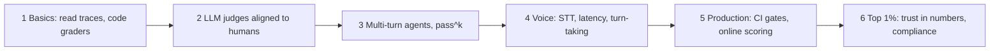

# Evals Mastery

A path from **"what is an eval?"** to **"I can build and run the eval system for a production voice agent at a bank."**

Plain words first. Only what real teams do in production. Every link was checked on 2026-10-07.

---

## The whole thing in one picture

Think of a bank call center.

| Real life | Evals world |
|---|---|
| A recording of a customer call | **Trace**: the full record of one conversation |
| A quality checklist for each call | **Grader**: code or an LLM that scores the call |
| A supervisor spot-checking the checklist | **Human labels**: checking the grader is right |
| Training calls with fake customers | **Simulation**: an LLM caller talks to your agent |
| Checking every call once the agent is live | **Online evals**: scoring real traffic |
| Compliance audit | **Fintech evals**: disclosures, identity checks, no card numbers read back |

## Start here

1. **[`ROADMAP.md`](ROADMAP.md)**: the full roadmap. It has a plain-words glossary, 6 levels, a voice + fintech deep dive, and how small, medium and large teams build evals. It also lists 6 projects, verified blogs, and OSS repos to study.

## What's inside ROADMAP.md

| Section | What it answers |
|---|---|
| 0. Plain words | What do trace, judge, pass^k, WER mean? |
| 1. The loop | What cycle do real teams repeat? |
| 2. Levels 1–6 | What do I learn, in what order? |
| 3. Voice agents for fintech | Where do voice agents break, and what do banks have to check? |
| 4. Small / medium / large | How do Nubank, Ramp, Airbnb, GitHub and Sierra do it? |
| 5. Projects | What do I build to prove I know it? |
| 6. Reading list | Which blogs, papers and repos should I study? |
| 7. Top 1% | What separates the best from the rest? |

## Key sources

- [τ-bench](https://taubench.com/) (Sierra): simulated customers, banking domain, real-time voice mode
- [Hamel Husain & Shreya Shankar, AI Evals FAQ](https://hamel.dev/blog/posts/evals-faq/)
- [Nubank: Building AI agents for 131 million customers](https://building.nu.com/building-ai-agents-for-131-million-customers/)
- [Pipecat Evals](https://docs.pipecat.ai/pipecat/evals/overview) and [LiveKit testing](https://docs.livekit.io/agents/build/testing)
