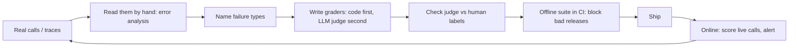
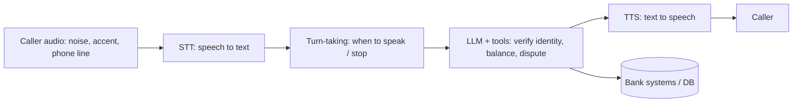

# Evals Roadmap: basics → top 1% (focus: voice agents for fintech)

All links below were found and checked to exist on 2026-10-07. Nothing here is made up. Where I give an opinion, it says "opinion".

---

## 0. Plain words first

| Word | Plain meaning | Example (voice bank agent) |
|---|---|---|
| Eval | A repeatable test that gives your AI a score | "Did the bot block a card when asked?" → pass/fail |
| Trace | The full recording of one conversation: audio, transcript, tool calls, timings | One customer call, start to hang-up |
| Golden dataset | A fixed list of test cases with known right answers | 200 real calls with "correct outcome" labels |
| Code grader | A check written in normal code | `assert tool_called == "freeze_card"` |
| LLM-as-judge | Another LLM grades the output against a rubric | "Did the agent read the required disclosure? yes/no" |
| Human label | A person marks pass/fail. Used to check the judge | Compliance officer reviews 100 calls |
| Offline eval | Run before shipping, on fixed data | CI run on every prompt change |
| Online eval | Run on live traffic after shipping | Judge scores a share (or all) of today's calls |
| Simulation | A fake caller (an LLM + TTS voice) talks to your agent | "Angry caller with accent and background noise disputes a charge" |
| pass@k / pass^k | pass@k: success in at least 1 of k tries. pass^k: success in **all** k tries | Banks care about pass^k (it must work every time) |
| WER | Word Error Rate: % of words speech-to-text got wrong | "fifteen" heard as "fifty" = 1 error, big money impact |
| TTFS / latency | Time from caller stopping to the agent responding | Long silence → caller talks again → chaos |
| Regression | Something that used to work is now broken | New model breaks the "lost card" flow |

**The one trap:** a high average score means nothing in fintech. One wrong account balance or one missing legal disclosure can be a regulatory problem. Industry tracks the **worst failures** and **reliability across repeats (pass^k)**, not only averages.

---

## 1. The loop every serious team runs

Source of this loop: Hamel Husain & Shreya Shankar's FAQ, Eugene Yan's "Product Evals in Three Simple Steps", Airbnb's "eval-driven development" (links in §6).

---

## 2. Levels

### Level 1: Basics (weeks 1–2)
- Read 50–100 real traces by hand. Write one note per failure. Group notes into failure types. (This is "error analysis". Every source in §6 says start here, not with tools.)
- Write code graders for anything checkable without judgment: right tool called, right arguments, JSON valid, amount matches DB.
- Run them with pytest or promptfoo.
- **Read:** Hamel "Your AI Product Needs Evals", Hamel+Shreya "Evals FAQ", Anthropic "Demystifying evals for AI agents".

### Level 2: LLM judges done properly (weeks 3–4)
- One judge per failure type. Binary pass/fail, not 1–10 scales (FAQ argues this).
- Label ~100 cases yourself. Measure judge agreement with you (true-positive and true-negative rate, not only accuracy).
- Keep a held-out set so you don't overfit the judge prompt.
- **Read:** Shankar et al. "Who Validates the Validators?" (EvalGen paper); Eugene Yan "Evaluating LLM-Evaluators"; Eugene Yan "AlignEval".

### Level 3: Agents and multi-turn (weeks 5–7)
- Judge the **end state**, not the words: after the conversation, is the database correct? (tau-bench scores by DB state + required info communicated.)
- Simulated users with personas and goals.
- Run each task k times; report pass^k.
- **Study:** `sierra-research/tau2-bench` (now τ³, has a **banking** domain and a **voice** mode), `docs/evaluation.md` in that repo.

### Level 4: Voice-specific (weeks 8–11) → see §3

### Level 5: Production (weeks 12–16)
- Evals in CI: every prompt/model/tool change runs the suite; regressions block merge.
- Online: sample or score 100% of live calls with judges; dashboards; alerts on failure-rate jumps.
- Every production failure becomes a new test case (Hamming and Airbnb both state this practice).
- Version prompts like code. Re-run full suite on every model upgrade (Nubank: newer models broke existing agents).

### Level 6: Top 1%
- You can say **how much to trust each number**: judge error rates, confidence intervals, sample size.
- You audit the benchmark itself (Sierra fixed 50+ broken tasks in τ-bench in Feb 2026: even famous evals have bugs).
- You design evals for compliance/risk teams, not only engineers (§3.4).
- You can tie eval scores to business metrics (Nubank: transactional NPS + LLM-judge on every conversation).

---

## 3. Voice agents for fintech (main focus)

### 3.1 Where voice agents break (each layer needs its own eval)

| Layer | What to measure | How industry measures it | Tool / source |
|---|---|---|---|
| STT | WER on **numbers, names, account IDs**, semantic WER | Benchmark on your own call audio, not public sets | `pipecat-ai/stt-benchmark` (semantic WER + TTFS) |
| Latency | Time-to-final-transcript, time-to-first-audio, p50/p95/p99 | Per-turn timing in traces | Pipecat TTFS docs, LiveKit metrics |
| Turn-taking | Interrupts caller? Handles barge-in? Waits on pauses? | Scripted barge-in tests, full-duplex benchmarks | Pipecat Evals (barge-in via `delay_ms`), Full-Duplex-Bench |
| Task (LLM + tools) | Correct end state in bank DB; correct tool args | Simulated callers + DB check, pass^k | τ³-bench banking + τ-voice |
| Conversation | Repeats, confusion, tone | LLM judges on transcripts | OpenAI Realtime Eval Guide |
| Compliance | Required disclosures said, forbidden things not said | Code checks + aligned LLM judges + human review | §3.4 |

### 3.2 Fintech failure types to build evals for
Opinion, based on the domains in τ³-banking and on lender-focused vendors (Salient, Prodigal, Parloa):
- Identity verification skipped or done after sharing account info.
- Wrong number heard: "$50" vs "$15", "fifteen" vs "fifty", account digits.
- Card number or CVV spoken back, logged, or stored in transcripts (PCI DSS issue).
- Debt collection: missing required disclosure, calling too often, wrong tone (FDCPA / Reg F).
- Dispute flow (Reg E): dispute not opened, wrong deadline promised.
- Promising things the agent cannot do ("your fee is waived") → UDAAP risk.
- Not handing off to a human when the caller asks or is distressed.

### 3.3 How a voice eval suite is actually built (pattern used by Pipecat, LiveKit, OpenAI cookbook, Coval/Hamming/Cekura)
1. **Unit-style tests in text** (fast, cheap): LiveKit `AgentSession` testing helpers with pytest; Pipecat Evals scripted scenarios with semantic assertions + LLM judge.
2. **Audio replays:** recorded caller audio (incl. noise, accents) fed to the full pipeline.
3. **Simulated callers:** LLM caller with goal + persona + TTS voice, run many times; check DB end state.
4. **Production monitoring:** every live call traced, scored by judges, worst calls reviewed by humans, then added to the test suite.

### 3.4 The regulatory side (what makes fintech different)
- US bank model-risk guidance: **SR 26-2** (Apr 17 2026) replaced SR 11-7. KPMG's summary says GenAI/agentic AI is not formally in scope but should still be governed. Your eval reports are the evidence risk teams ask for.
- Laws that apply to AI calls the same as human calls (Parloa's banking compliance guide lists them): UDAAP, Reg E, FDCPA, CFPB complaint handling.
- Industry paper: "Benchmarks Are Not Validation: A System-Level View of Financial LLM Applications" (arXiv 2607.28840): argues for multi-layer validation and limits of LLM-as-judge in finance.

---

## 4. Small vs medium vs large: how it is built in industry

| | Small (1–3 engineers, pilot) | Medium (product team, real traffic) | Large (bank / big tech scale) |
|---|---|---|---|
| Data | 50–200 hand-labeled traces | 1k+ labeled, growing from prod failures | Continuous labeling, sampling across markets/languages |
| Graders | Code checks + 1–3 judges | Judge per failure type, aligned to humans | Judge on **every** conversation (Nubank) + human audit |
| Voice tests | Scripted text tests (LiveKit/Pipecat) | + audio replays + simulated callers | + full-duplex sims at thousands of runs, red-teaming (Nubank) |
| Tools | pytest, promptfoo | Langfuse / Phoenix / Braintrust; Coval/Hamming/Cekura for voice | Internal platform (Airbnb, GitHub, LinkedIn built their own) |
| Release gate | Manual review of results | CI blocks regressions | CI + offline suite + staged rollout + A/B on business metric |
| Fintech extra | Compliance checklist as code | Compliance judges reviewed by compliance team | Model-risk documentation, audit trail, independent validation |

Real examples to study:
- **Nubank** (131M customers): LLM auditor on 100% of conversations with binary criteria; simulation + red-teaming before launch; prompts versioned like code.
- **Ramp**: builds financial-task benchmarks from production use cases to compare models.
- **Airbnb**: eval-driven development; separate post on cutting LLM eval time from weeks to a day.
- **GitHub Copilot**: offline evals before every production change; MCP server offline eval for tool selection.
- **Sierra**: τ-bench family, voice + banking.

---

## 5. Projects for you to build (in order)

| Size | Project | What it teaches |
|---|---|---|
| Small | STT eval on fintech speech: record/collect clips with amounts, card digits, names; compute WER + "number error rate" for 2–3 STT providers | Code graders, why generic WER hides money errors |
| Small | Text-mode banking agent (block card, check balance) with pytest/LiveKit tests for tool calls | Code graders on tool args |
| Medium | Add LLM judges for disclosure + identity-verification; label 100 calls; measure judge agreement | Judge alignment |
| Medium | Simulated caller harness (persona + goal + TTS), DB end-state check, run each task 5×, report pass^5 | τ-bench method |
| Large | Full pipeline: CI gate + online scoring of live calls + dashboard + "failure → new test" loop + a model-risk style report | Production evals end to end |
| Large | Run your agent on τ³-bench banking (text, then voice mode) | Comparing to public leaderboard |

---

## 6. Reading list (verified links)

**Foundations**
- Hamel Husain, Your AI Product Needs Evals: https://hamel.dev/blog/posts/evals/
- Hamel Husain & Shreya Shankar, AI Evals FAQ: https://hamel.dev/blog/posts/evals-faq/
- Eugene Yan, Task-Specific LLM Evals that Do & Don't Work: https://eugeneyan.com/writing/evals/
- Eugene Yan, Product Evals in Three Simple Steps: https://eugeneyan.com/writing/product-evals
- Eugene Yan, Evaluating LLM-Evaluators: https://eugeneyan.com/writing/llm-evaluators
- Shankar et al., Who Validates the Validators?: https://arxiv.org/abs/2404.12272
- Anthropic, Demystifying evals for AI agents: https://www.anthropic.com/engineering/demystifying-evals-for-ai-agents

**Industry engineering blogs**
- Airbnb, Eval-driven development: https://airbnb.tech/ai-ml/eval-driven-development-lessons-from-evaluating-genai-at-scale
- Airbnb, From weeks to a day (fast LLM eval): https://medium.com/airbnb-engineering/from-weeks-to-a-day-how-we-made-llm-evaluation-fast-enough-to-iterate-on-14e2d35198b4
- GitHub, How we evaluate models for Copilot: https://github.blog/ai-and-ml/generative-ai/how-we-evaluate-models-for-github-copilot
- GitHub, Offline evaluation of GitHub MCP Server: https://github.blog/ai-and-ml/generative-ai/measuring-what-matters-how-offline-evaluation-of-github-mcp-server-works
- LinkedIn, Musings on building a Generative AI product: https://www.linkedin.com/blog/engineering/generative-ai/musings-on-building-a-generative-ai-product

**Fintech**
- Nubank, Building AI agents for 131 million customers: https://building.nu.com/building-ai-agents-for-131-million-customers/
- Ramp, Financial Benchmarks: https://builders.ramp.com/post/financial-benchmarks
- Federal Reserve SR 26-2 (model risk, 2026): https://www.federalreserve.gov/supervisionreg/srletters/SR2602.pdf
- Benchmarks Are Not Validation (financial LLM apps): https://arxiv.org/pdf/2607.28840
- Parloa, AI for compliance in banking: https://www.parloa.com/knowledge-hub/ai-for-compliance-in-banking/
- Prodigal, Redefining AI accuracy for collections: https://www.prodigaltech.com/blog/redefining-ai-accuracy-for-collections-and-loan-servicing

**Voice evals**
- Sierra, τ-voice blog: https://sierra.ai/blog/tau-voice-benchmarking-real-time-voice-agents-on-real-world-tasks
- τ-voice paper: https://arxiv.org/abs/2603.13686
- τ-bench site + leaderboards (τ³-banking, τ³-voice): https://taubench.com/
- OpenAI, Realtime Eval Guide: https://developers.openai.com/cookbook/examples/realtime_eval_guide
- OpenAI, GPT-Live voice agent evaluation guide: https://developers.openai.com/cookbook/examples/audio/voice_agent_evaluation
- LiveKit, Testing and evaluation: https://docs.livekit.io/agents/build/testing
- Pipecat Evals: https://docs.pipecat.ai/pipecat/evals/overview
- Full-Duplex-Bench (turn-taking): https://arxiv.org/abs/2503.04721
- VoiceBench: https://github.com/matthewcym/voicebench
- Hamming, Voice agent evaluation guide: https://hamming.ai/blog/building-genai-voice-agents-evaluation
- Cekura, Voice AI simulation: https://www.cekura.ai/blogs/voice-ai-simulation
- (Vendor blogs from Hamming/Coval/Cekura are useful but are marketing too; read the methods, ignore the comparisons.)

**OSS to read the code of**

| Repo | Why read it |
|---|---|
| https://github.com/sierra-research/tau2-bench | Simulated users, DB-state grading, pass^k, banking + full-duplex voice (`src/tau2/voice/`) |
| https://github.com/pipecat-ai/pipecat (`src/pipecat/evals/`) | Voice scenario tests, barge-in, judges |
| https://github.com/pipecat-ai/stt-benchmark | STT latency + semantic WER |
| https://github.com/livekit/agents | pytest-based agent tests, STT/TTS suites |
| https://github.com/openai/openai-cookbook (`examples/Realtime_eval_guide.ipynb`) | Realtime voice eval harness |
| https://github.com/vibrantlabsai/ragas | RAG metrics (for knowledge-base answers) |
| https://github.com/ai-evals-course/evals-skills | Evals process material from the FAQ authors (replaces the deprecated `hamelsmu/evals-skills`) |

---

## 7. What separates top 1%

1. Reads traces before writing any metric.
2. Code checks wherever possible; LLM judges only where judgment is needed, and every judge has a measured error rate.
3. Grades **outcomes** (DB state, money moved, disclosure said), not wording.
4. Reports pass^k and worst-case slices (accents, noise, numbers), not one average.
5. Every production failure becomes a test within days.
6. Can hand a compliance/model-risk team an eval report they accept.
