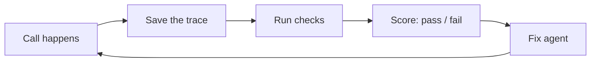

# Lesson 1: What is an eval?

## The idea

A bank checks a sample of its human agents' calls against a checklist: "Did they verify identity? Did they read the disclosure? Was the amount right?"

An **eval** is the same checklist, written so a computer can run it on your AI agent's calls, again and again, after every change.

## Words

| Word | Full name | What it does | Example |
|---|---|---|---|
| Trace | Conversation record | Everything from one call: transcript, tool calls, timings | One customer call, start to hang-up |
| Grader | Checker | Decides pass or fail | "Was `freeze_card` called?" |
| Code grader | Check written in normal code | Exact, cheap, never changes its mind | `tool == "freeze_card"` |
| LLM judge | An AI used as a grader | Checks things that need judgment | "Was identity verified *before* the balance was shared?" |
| Golden set | Hand-labeled test cases | The answer key | 100 calls you marked pass/fail yourself |

## The one trap to remember

Don't start with tools or metrics. Start by **reading your own calls** to see what actually breaks. Every serious team (Hamel Husain, Airbnb, Monzo) starts there.

## Why it matters

If your agent succeeds 75% of the time on one try, it succeeds on all 3 of 3 tries only about 42% of the time ($0.75^3$). This example is from [Anthropic, Demystifying evals for AI agents](https://www.anthropic.com/engineering/demystifying-evals-for-ai-agents). A bank needs the agent to work *every* time, and only evals show you that number.

## Your answers

- **Stack:** LiveKit Agents, deployed on our own server. All transcripts and recordings are saved.
- **Must never get wrong:**
  - guardrails must never be broken (industry name: policy / compliance checks)
  - answers must match the knowledge base (industry name: correctness / faithfulness; Nubank's judge asks "does the answer contradict our knowledge base?")

## Read more

- Hamel Husain, [Your AI Product Needs Evals](https://hamel.dev/blog/posts/evals/)
- Anthropic, [Demystifying evals for AI agents](https://www.anthropic.com/engineering/demystifying-evals-for-ai-agents)
