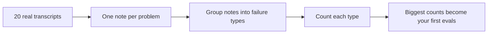

# Lesson 2: Read your calls before you measure anything

## The idea

A new quality manager doesn't write a checklist on day one. She listens to calls, writes down every problem she hears, and only then groups those notes into a checklist. This is called **error analysis**.

## Words

| Word | Full name | What it does | Example |
|---|---|---|---|
| KB | Knowledge base | The bank's official answers and documents | "Card replacement fee is $5" |
| Error analysis | Studying failures by hand | Finds what actually breaks | Reading 20 calls |
| Open coding | Free-text notes | One plain sentence per problem | "Told balance before asking DOB" |
| Axial coding | Grouping the notes | Turns notes into failure types | "Identity skipped" (6 calls) |
| Failure type | A named, repeated problem | One failure type usually becomes one eval | "Fee not in KB" |

## The one trap to remember

Don't pick the categories before you read. Write down what you *see*. The groups come afterwards.

## Why it matters

Airbnb read 100 outputs and found 15 faithfulness errors, 8 too-wordy, 5 wrong refusals and 3 broken JSON. The counts told them what to fix first, before they wrote any code. Source: [Airbnb, Eval-driven development](https://airbnb.tech/ai-ml/eval-driven-development-lessons-from-evaluating-genai-at-scale).

## Your turn

1. Write down your guardrails as a list. Each one should be a yes/no sentence, for example: "Agent never reads back a full card number."
2. Read **20 transcripts**. In a spreadsheet with columns `call_id` and `what went wrong`, write one plain sentence per problem. Skip calls with no problem.

## Read more

- Hamel Husain & Shreya Shankar, [AI Evals FAQ](https://hamel.dev/blog/posts/evals-faq/): the error analysis sections
- [`ai-evals-course/evals-skills`](https://github.com/ai-evals-course/evals-skills): `skills/error-discovery/`
